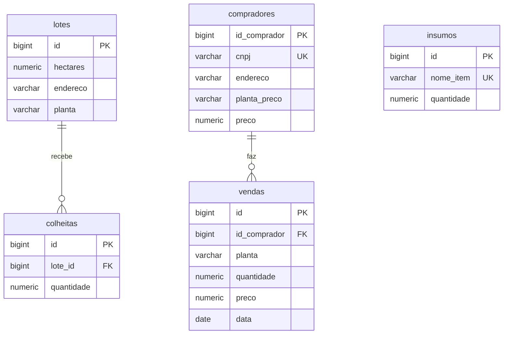

# Modelo de domínio

Sistema de manejo e comercialização agrícola (tema: Agronegócio). Aqui estão as entidades, os relacionamentos e o diagrama das tabelas.

## Entidades

| Entidade | Tabela | O que representa |
|---|---|---|
| `Lote` | `lotes` | Um talhão: área de terra onde uma planta é cultivada |
| `Insumo` | `insumos` | Produto usado no plantio (adubo, semente, defensivo) e a quantidade em estoque |
| `Comprador` | `compradores` | Empresa ou pessoa que compra a produção, com o preço combinado para uma planta |
| `Colheita` | `colheitas` | Registro de quanto foi colhido (em sacas) de um lote |
| `Venda` | `vendas` | Venda de uma planta para um comprador, com quantidade, preço e data |

## Atributos

### Lote (`lotes`)

| Atributo | Coluna | Tipo Java | Tipo SQL | Regra |
|---|---|---|---|---|
| `id` | `id` | `Long` | `BIGSERIAL` | Chave primária |
| `hectares` | `hectares` | `BigDecimal` | `NUMERIC(10,2)` | Obrigatório, maior que zero |
| `endereco` | `endereco` | `String` | `VARCHAR(255)` | Obrigatório |
| `planta` | `planta` | `String` | `VARCHAR(100)` | Obrigatório (ex.: Soja, Milho) |

### Insumo (`insumos`)

| Atributo | Coluna | Tipo Java | Tipo SQL | Regra |
|---|---|---|---|---|
| `id` | `id` | `Long` | `BIGSERIAL` | Chave primária |
| `nomeItem` | `nome_item` | `String` | `VARCHAR(100)` | Obrigatório e único |
| `quantidade` | `quantidade` | `BigDecimal` | `NUMERIC(12,2)` | Obrigatório, zero ou mais |

### Comprador (`compradores`)

| Atributo | Coluna | Tipo Java | Tipo SQL | Regra |
|---|---|---|---|---|
| `id` | `id_comprador` | `Long` | `BIGSERIAL` | Chave primária |
| `cnpj` | `cnpj` | `String` | `VARCHAR(14)` | Obrigatório, único, CNPJ válido (guardado só com números) |
| `endereco` | `endereco` | `String` | `VARCHAR(255)` | Obrigatório |
| `plantaPreco` | `planta_preco` | `String` | `VARCHAR(100)` | Planta para a qual o preço foi combinado |
| `preco` | `preco` | `BigDecimal` | `NUMERIC(12,2)` | Preço combinado por saca, maior que zero |

### Colheita (`colheitas`)

| Atributo | Coluna | Tipo Java | Tipo SQL | Regra |
|---|---|---|---|---|
| `id` | `id` | `Long` | `BIGSERIAL` | Chave primária |
| `lote` | `lote_id` | `Lote` | `BIGINT` | Chave estrangeira para `lotes(id)` |
| `quantidade` | `quantidade` | `BigDecimal` | `NUMERIC(12,2)` | Sacas colhidas, maior que zero |

### Venda (`vendas`)

| Atributo | Coluna | Tipo Java | Tipo SQL | Regra |
|---|---|---|---|---|
| `id` | `id` | `Long` | `BIGSERIAL` | Chave primária |
| `comprador` | `id_comprador` | `Comprador` | `BIGINT` | Chave estrangeira para `compradores(id_comprador)` |
| `planta` | `planta` | `String` | `VARCHAR(100)` | Planta vendida |
| `quantidade` | `quantidade` | `BigDecimal` | `NUMERIC(12,2)` | Sacas vendidas, maior que zero |
| `preco` | `preco` | `BigDecimal` | `NUMERIC(12,2)` | Preço por saca praticado na venda, maior que zero |
| `data` | `data` | `LocalDate` | `DATE` | Data da venda |

## Relacionamentos

| Relacionamento | Tipo | Onde fica a chave estrangeira |
|---|---|---|
| Um `Lote` tem várias `Colheita` | 1 para N | `colheitas.lote_id` |
| Um `Comprador` faz várias `Venda` | 1 para N | `vendas.id_comprador` |

`Insumo` não se liga a outra tabela: é um cadastro de estoque de materiais.

Colheita e venda também se encontram pela **planta**, mas sem chave estrangeira: o estoque de uma planta é o total colhido nos lotes dessa planta menos o total já vendido (regra RN03).

## Diagrama das tabelas

## Migrations

| Arquivo | O que cria |
|---|---|
| `V1__criar_lotes.sql` | Tabela `lotes` |
| `V2__criar_insumos.sql` | Tabela `insumos` |
| `V3__criar_compradores.sql` | Tabela `compradores` |
| `V4__criar_colheitas.sql` | Tabela `colheitas`, com chave estrangeira para `lotes` |
| `V5__criar_vendas.sql` | Tabela `vendas`, com chave estrangeira para `compradores` |

Nenhuma tabela é criada fora das migrations: o Hibernate só confere (`ddl-auto=validate`) se cada entidade bate com a sua tabela.
